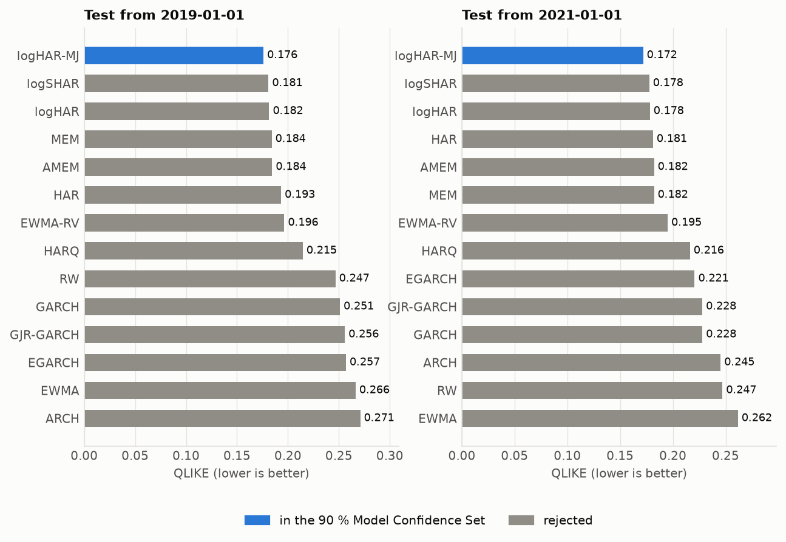
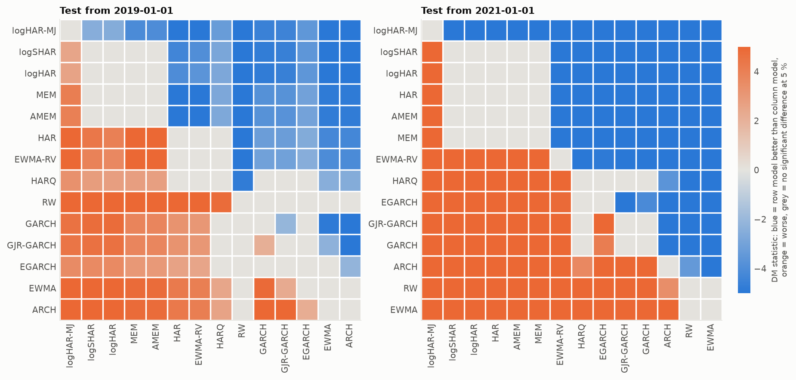
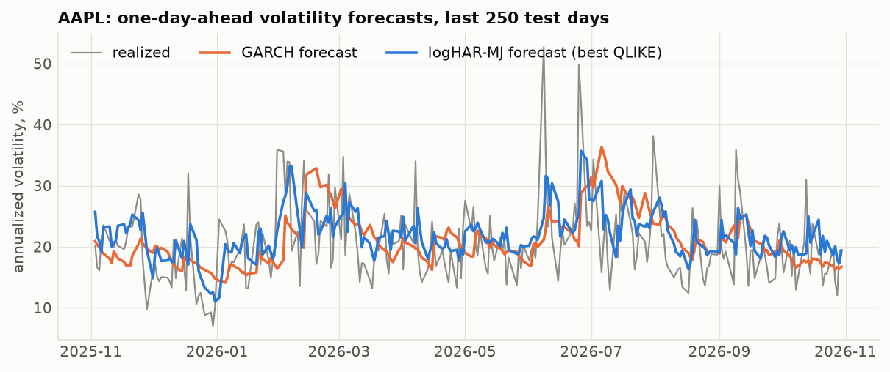

# Econometric volatility forecasts: combined

Run `20261114-183138_expanding_tuned` (2026-11-14T18:31:50, 258.3 s, commit 737cb4a).

## Settings

- **Dataset**: combined, 50 assets, 2009-09-25 to 2026-10-30 (163,206 asset-days, 42 masked)
- **Target**: log(rv5) of the next session; QLIKE is scored on rv5 itself
- **Splitting policy**: expanding: re-estimated every 252 days on all past data; test cutoffs 2019-01-01, 2021-01-01
- **Hyperparameters**: selected by QLIKE on 2 validation year(s) before each cutoff, then the model is re-estimated on the whole training period (values in the tables below)
- **Tests**: benchmark logHAR; Model Confidence Set at 90 % (2000 stationary-bootstrap draws, mean block 10 days)

## Test from 2019-01-01

98,543 forecasts on 2,032 days (2019-01-02 to 2026-10-29), 9 estimation(s).

|   rank | model     |   QLIKE |   vs benchmark, % |   DM stat |   DM p-value |   assets better |   assets worse |   MCS p-value | in MCS   |   MSE log RV |    MSE RV |
|-------:|:----------|--------:|------------------:|----------:|-------------:|----------------:|---------------:|--------------:|:---------|-------------:|----------:|
|      1 | logHAR-MJ |  0.1759 |           -3.0912 |   -2.5405 |       0.0111 |              20 |              0 |        1.0000 | yes      |       0.2784 | 2.426e-07 |
|      2 | logSHAR   |  0.1809 |           -0.3602 |   -1.9143 |       0.0556 |              12 |              0 |        0.0320 |          |       0.2863 | 2.548e-07 |
|      3 | logHAR    |  0.1815 |            0.0000 |           |              |                 |                |        0.0320 |          |       0.2874 | 2.559e-07 |
|      4 | MEM       |  0.1840 |            1.3625 |    0.4716 |       0.6372 |               0 |              9 |        0.0075 |          |       0.3260 | 2.836e-07 |
|      5 | AMEM      |  0.1844 |            1.5941 |    0.5339 |       0.5934 |               1 |              7 |        0.0080 |          |       0.3263 | 2.867e-07 |
|      6 | HAR       |  0.1932 |            6.4313 |    4.0094 |       0.0001 |               0 |             19 |        0.0000 |          |       0.3428 | 2.747e-07 |
|      7 | EWMA-RV   |  0.1964 |            8.1861 |    3.6682 |       0.0002 |               0 |             32 |        0.0000 |          |       0.3258 | 2.638e-07 |
|      8 | HARQ      |  0.2145 |           18.1647 |    2.7621 |       0.0057 |               0 |             16 |        0.0125 |          |       0.3457 | 2.493e-07 |
|      9 | RW        |  0.2466 |           35.8193 |   13.5214 |       0.0000 |               0 |             50 |        0.0000 |          |       0.3822 | 3.609e-07 |
|     10 | GARCH     |  0.2510 |           38.2434 |    4.7731 |       0.0000 |               0 |             49 |        0.0020 |          |       0.4180 | 3.322e-07 |
|     11 | GJR-GARCH |  0.2558 |           40.9219 |    4.5959 |       0.0000 |               0 |             48 |        0.0020 |          |       0.4182 | 3.453e-07 |
|     12 | EGARCH    |  0.2569 |           41.5053 |    3.5571 |       0.0004 |               0 |             46 |        0.0125 |          |       0.4082 | 3.161e-07 |
|     13 | EWMA      |  0.2664 |           46.7225 |    6.0343 |       0.0000 |               0 |             50 |        0.0005 |          |       0.4354 | 3.412e-07 |
|     14 | ARCH      |  0.2710 |           49.2533 |    5.9523 |       0.0000 |               0 |             50 |        0.0000 |          |       0.4454 | 3.980e-07 |

QLIKE by asset class (number of forecasts in brackets):

| model     |   forex (10,160) |   futures (9,778) |   stocks (78,605) |
|:----------|-----------------:|------------------:|------------------:|
| logHAR-MJ |           0.1514 |            0.1682 |            0.1801 |
| logSHAR   |           0.1516 |            0.1675 |            0.1863 |
| logHAR    |           0.1523 |            0.1690 |            0.1869 |
| MEM       |           0.1552 |            0.1686 |            0.1897 |
| AMEM      |           0.1555 |            0.1668 |            0.1904 |
| HAR       |           0.2052 |            0.1756 |            0.1939 |
| EWMA-RV   |           0.1637 |            0.1753 |            0.2033 |
| HARQ      |           0.1993 |            0.3538 |            0.1992 |
| RW        |           0.2198 |            0.2582 |            0.2486 |
| GARCH     |           0.2019 |            0.2076 |            0.2627 |
| GJR-GARCH |           0.2022 |            0.2098 |            0.2685 |
| EGARCH    |           0.2036 |            0.2095 |            0.2697 |
| EWMA      |           0.2104 |            0.2315 |            0.2780 |
| ARCH      |           0.2130 |            0.2201 |            0.2848 |

Hyperparameters used:

| model     | hyperparameters                   |   candidates |   validation QLIKE |   with default values |
|:----------|:----------------------------------|-------------:|-------------------:|----------------------:|
| RW        | none                              |            1 |                    |                       |
| EWMA      | lambda = 0.94                     |            6 |             0.2629 |                0.2629 |
| EWMA-RV   | none                              |            1 |                    |                       |
| ARCH      | p = 22, dist = t                  |           10 |             0.2595 |                0.2907 |
| GARCH     | p = 1, q = 2, dist = t            |            8 |             0.2503 |                0.2563 |
| GJR-GARCH | p = 1, q = 2, dist = t            |            4 |             0.2464 |                0.2548 |
| EGARCH    | p = 1, q = 2, dist = t            |            4 |           117.7133 |             8821.3259 |
| HAR       | pooling = pooled, estimator = wls |            4 |             0.1834 |                0.2139 |
| HARQ      | pooling = pooled, estimator = wls |            4 |             0.1863 |                0.1981 |
| logHAR    | pooling = per_asset               |            2 |             0.1792 |                0.1804 |
| logHAR-MJ | pooling = per_asset               |            2 |             0.1712 |                0.1765 |
| logSHAR   | pooling = per_asset               |            2 |             0.1788 |                0.1803 |
| MEM       | p = 2, q = 2                      |            4 |             0.1850 |                0.1877 |
| AMEM      | p = 2, q = 2                      |            4 |             0.1859 |                0.1883 |

## Test from 2021-01-01

73,259 forecasts on 1,513 days (2021-01-04 to 2026-10-29), 7 estimation(s).

|   rank | model     |   QLIKE |   vs benchmark, % |   DM stat |   DM p-value |   assets better |   assets worse |   MCS p-value | in MCS   |   MSE log RV |    MSE RV |
|-------:|:----------|--------:|------------------:|----------:|-------------:|----------------:|---------------:|--------------:|:---------|-------------:|----------:|
|      1 | logHAR-MJ |  0.1718 |           -3.5897 |   -4.9860 |       0.0000 |              25 |              1 |        1.0000 | yes      |       0.2695 | 1.937e-07 |
|      2 | logSHAR   |  0.1776 |           -0.3278 |   -0.3856 |       0.6998 |              12 |              0 |        0.0000 |          |       0.2778 | 1.951e-07 |
|      3 | logHAR    |  0.1782 |            0.0000 |           |              |                 |                |        0.0000 |          |       0.2792 | 1.963e-07 |
|      4 | HAR       |  0.1811 |            1.6589 |    1.0233 |       0.3062 |               0 |             18 |        0.0000 |          |       0.3123 | 2.263e-07 |
|      5 | AMEM      |  0.1822 |            2.2252 |    1.2027 |       0.2291 |               1 |             23 |        0.0000 |          |       0.3202 | 2.638e-07 |
|      6 | MEM       |  0.1822 |            2.2257 |    1.3623 |       0.1731 |               0 |             26 |        0.0000 |          |       0.3209 | 2.598e-07 |
|      7 | EWMA-RV   |  0.1950 |            9.4601 |    8.2341 |       0.0000 |               0 |             44 |        0.0000 |          |       0.3202 | 2.314e-07 |
|      8 | HARQ      |  0.2162 |           21.3336 |    9.6334 |       0.0000 |               0 |             23 |        0.0000 |          |       0.4202 | 2.036e-07 |
|      9 | EGARCH    |  0.2206 |           23.8155 |    8.4711 |       0.0000 |               0 |             45 |        0.0000 |          |       0.3770 | 2.098e-07 |
|     10 | GJR-GARCH |  0.2279 |           27.8964 |   10.1141 |       0.0000 |               0 |             45 |        0.0000 |          |       0.3902 | 2.196e-07 |
|     11 | GARCH     |  0.2279 |           27.9231 |    8.8953 |       0.0000 |               0 |             47 |        0.0000 |          |       0.3957 | 2.172e-07 |
|     12 | ARCH      |  0.2452 |           37.6109 |   13.3050 |       0.0000 |               0 |             47 |        0.0000 |          |       0.4220 | 2.274e-07 |
|     13 | RW        |  0.2470 |           38.6194 |   14.5401 |       0.0000 |               0 |             50 |        0.0000 |          |       0.3793 | 3.306e-07 |
|     14 | EWMA      |  0.2617 |           46.8605 |   14.0544 |       0.0000 |               0 |             49 |        0.0000 |          |       0.4181 | 2.232e-07 |

QLIKE by asset class (number of forecasts in brackets):

| model     |   forex (7,565) |   futures (7,289) |   stocks (58,405) |
|:----------|----------------:|------------------:|------------------:|
| logHAR-MJ |          0.1552 |            0.1672 |            0.1745 |
| logSHAR   |          0.1583 |            0.1702 |            0.1810 |
| logHAR    |          0.1588 |            0.1708 |            0.1816 |
| HAR       |          0.1563 |            0.1681 |            0.1860 |
| AMEM      |          0.1583 |            0.1668 |            0.1872 |
| MEM       |          0.1578 |            0.1688 |            0.1870 |
| EWMA-RV   |          0.1669 |            0.1751 |            0.2012 |
| HARQ      |          0.4023 |            0.1902 |            0.1953 |
| EGARCH    |          0.1859 |            0.1986 |            0.2279 |
| GJR-GARCH |          0.1848 |            0.1953 |            0.2375 |
| GARCH     |          0.1874 |            0.1955 |            0.2372 |
| ARCH      |          0.1997 |            0.2103 |            0.2555 |
| RW        |          0.2293 |            0.2601 |            0.2477 |
| EWMA      |          0.2208 |            0.2164 |            0.2726 |

Hyperparameters used:

| model     | hyperparameters                      |   candidates |   validation QLIKE |   with default values |
|:----------|:-------------------------------------|-------------:|-------------------:|----------------------:|
| RW        | none                                 |            1 |                    |                       |
| EWMA      | lambda = 0.9                         |            6 |             0.3201 |                0.3393 |
| EWMA-RV   | none                                 |            1 |                    |                       |
| ARCH      | p = 22, dist = t                     |           10 |             0.3469 |                0.4189 |
| GARCH     | p = 1, q = 1, dist = t               |            8 |             0.3227 |                0.3324 |
| GJR-GARCH | p = 1, q = 2, dist = t               |            4 |             0.3383 |                0.3527 |
| EGARCH    | p = 1, q = 2, dist = t               |            4 |             0.3635 |                0.3881 |
| HAR       | pooling = per_asset, estimator = wls |            4 |             0.1906 |                0.2356 |
| HARQ      | pooling = pooled, estimator = ols    |            4 |             0.2162 |                0.2162 |
| logHAR    | pooling = pooled                     |            2 |             0.1944 |                0.1944 |
| logHAR-MJ | pooling = per_asset                  |            2 |             0.1867 |                0.1898 |
| logSHAR   | pooling = pooled                     |            2 |             0.1944 |                0.1944 |
| MEM       | p = 1, q = 2                         |            4 |             0.1901 |                0.1915 |
| AMEM      | p = 1, q = 2                         |            4 |             0.1913 |                0.1927 |

## How to read the table

- **QLIKE** is the loss to minimize (0 = perfect forecast). Models are ranked on it.
- **DM stat / p-value**: Diebold-Mariano test against logHAR on the daily loss averaged across assets. A negative statistic means the model beats the benchmark; the difference is significant at 5 % when the p-value is below 0.05.
- **assets better / worse**: number of assets (out of 50) where the model is significantly better / worse than the benchmark at 5 % when the test is run asset by asset.
- **in MCS**: the model belongs to the Model Confidence Set, the smallest group of models that contains the best one with the stated confidence. Models outside it are significantly worse than the best.
- **MSE log RV** is the mean squared error on log(rv5), the criterion of the DL and foundation-model branches, on the same asset-days when the dataset is stocks.
- **MSE RV** is the mean squared error on rv5 itself. A handful of crisis days carry most of it, so it is much noisier than QLIKE.

## Figures

