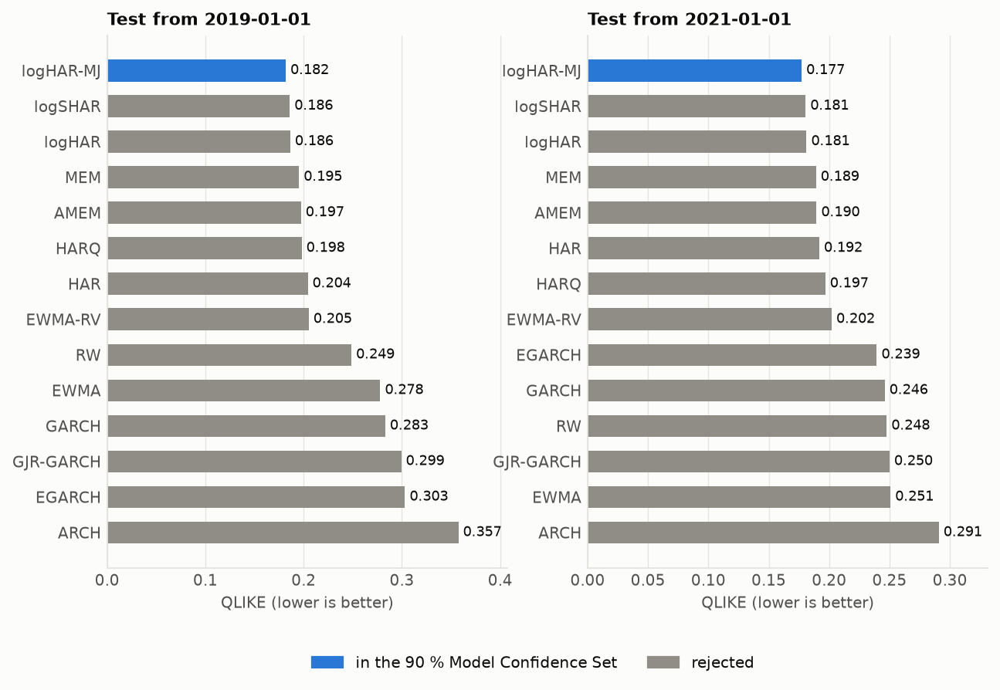
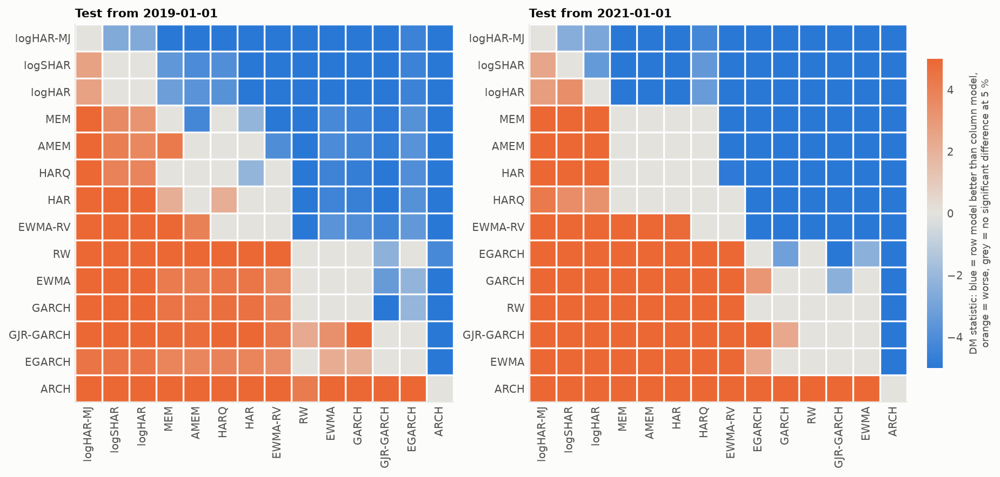
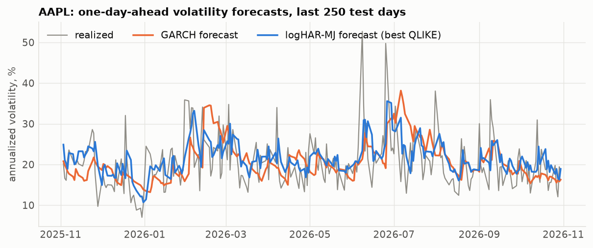

# Econometric volatility forecasts: stocks

Run `20261113-194018_fixed` (2026-11-13T19:40:27, 21.0 s, commit 80dc556).

## Settings

- **Dataset**: stocks, 40 assets, 2015-01-02 to 2026-10-30 (119,000 asset-days, 6 masked)
- **Target**: log(rv5) of the next session; QLIKE is scored on rv5 itself
- **Splitting policy**: fixed: one estimation on all data before the cutoff; test cutoffs 2019-01-01, 2021-01-01
- **Hyperparameters**: EWMA lambda 0.94, ARCH order 5, GARCH errors normal, HAR estimation pooled with lags 1/5/22
- **Tests**: benchmark logHAR; Model Confidence Set at 90 % (2000 stationary-bootstrap draws, mean block 10 days)

## Test from 2019-01-01

78,605 forecasts on 1,968 days (2019-01-02 to 2026-10-29), 1 estimation(s).

|   rank | model     |   QLIKE |   vs benchmark, % |   DM stat |   DM p-value |   assets better |   assets worse |   MCS p-value | in MCS   |   MSE log RV |
|-------:|:----------|--------:|------------------:|----------:|-------------:|----------------:|---------------:|--------------:|:---------|-------------:|
|      1 | logHAR-MJ |  0.1818 |           -2.4591 |   -2.6517 |       0.0080 |              21 |              0 |        1.0000 | yes      |       0.2831 |
|      2 | logSHAR   |  0.1859 |           -0.2587 |   -1.6747 |       0.0940 |               7 |              0 |        0.0110 |          |       0.2903 |
|      3 | logHAR    |  0.1863 |            0.0000 |           |              |                 |                |        0.0110 |          |       0.2910 |
|      4 | MEM       |  0.1953 |            4.8120 |    3.1793 |       0.0015 |               0 |             23 |        0.0000 |          |       0.3323 |
|      5 | AMEM      |  0.1973 |            5.8553 |    3.6795 |       0.0002 |               0 |             25 |        0.0000 |          |       0.3343 |
|      6 | HARQ      |  0.1979 |            6.2262 |    3.7703 |       0.0002 |               0 |             18 |        0.0000 |          |       0.3424 |
|      7 | HAR       |  0.2042 |            9.5707 |    8.1016 |       0.0000 |               0 |             37 |        0.0000 |          |       0.3635 |
|      8 | EWMA-RV   |  0.2052 |           10.1055 |    6.1460 |       0.0000 |               0 |             37 |        0.0000 |          |       0.3339 |
|      9 | RW        |  0.2486 |           33.4099 |   14.8176 |       0.0000 |               0 |             40 |        0.0000 |          |       0.3860 |
|     10 | EWMA      |  0.2780 |           49.1614 |    5.3227 |       0.0000 |               0 |             40 |        0.0000 |          |       0.4442 |
|     11 | GARCH     |  0.2830 |           51.8769 |    5.5765 |       0.0000 |               0 |             39 |        0.0000 |          |       0.4332 |
|     12 | GJR-GARCH |  0.2993 |           60.5989 |    5.8734 |       0.0000 |               0 |             39 |        0.0000 |          |       0.4445 |
|     13 | EGARCH    |  0.3031 |           62.6526 |    4.4779 |       0.0000 |               0 |             37 |        0.0000 |          |       0.4359 |
|     14 | ARCH      |  0.3574 |           91.8091 |    7.3189 |       0.0000 |               0 |             39 |        0.0000 |          |       0.5046 |

## Test from 2021-01-01

58,405 forecasts on 1,463 days (2021-01-04 to 2026-10-29), 1 estimation(s).

|   rank | model     |   QLIKE |   vs benchmark, % |   DM stat |   DM p-value |   assets better |   assets worse |   MCS p-value | in MCS   |   MSE log RV |
|-------:|:----------|--------:|------------------:|----------:|-------------:|----------------:|---------------:|--------------:|:---------|-------------:|
|      1 | logHAR-MJ |  0.1772 |           -2.2466 |   -2.8029 |       0.0051 |              17 |              0 |        1.0000 | yes      |       0.2735 |
|      2 | logSHAR   |  0.1805 |           -0.4049 |   -3.3911 |       0.0007 |              11 |              1 |        0.0175 |          |       0.2805 |
|      3 | logHAR    |  0.1813 |            0.0000 |           |              |                 |                |        0.0055 |          |       0.2821 |
|      4 | MEM       |  0.1891 |            4.3406 |    5.0671 |       0.0000 |               0 |             27 |        0.0000 |          |       0.3265 |
|      5 | AMEM      |  0.1896 |            4.5800 |    4.9962 |       0.0000 |               0 |             28 |        0.0000 |          |       0.3265 |
|      6 | HAR       |  0.1918 |            5.8274 |    8.8700 |       0.0000 |               0 |             24 |        0.0000 |          |       0.3441 |
|      7 | HARQ      |  0.1968 |            8.5591 |    3.2892 |       0.0010 |               0 |             25 |        0.0020 |          |       0.3327 |
|      8 | EWMA-RV   |  0.2021 |           11.4765 |   11.3358 |       0.0000 |               0 |             40 |        0.0000 |          |       0.3249 |
|      9 | EGARCH    |  0.2394 |           32.0962 |   10.4940 |       0.0000 |               0 |             37 |        0.0000 |          |       0.3909 |
|     10 | GARCH     |  0.2460 |           35.7165 |   10.7057 |       0.0000 |               0 |             39 |        0.0000 |          |       0.4012 |
|     11 | RW        |  0.2477 |           36.6315 |   17.3965 |       0.0000 |               0 |             40 |        0.0000 |          |       0.3817 |
|     12 | GJR-GARCH |  0.2500 |           37.9017 |   12.6651 |       0.0000 |               0 |             38 |        0.0000 |          |       0.4043 |
|     13 | EWMA      |  0.2508 |           38.3567 |    9.1665 |       0.0000 |               0 |             40 |        0.0000 |          |       0.4123 |
|     14 | ARCH      |  0.2908 |           60.4516 |   16.9014 |       0.0000 |               0 |             38 |        0.0000 |          |       0.4652 |

## How to read the table

- **QLIKE** is the loss to minimize (0 = perfect forecast). Models are ranked on it.
- **DM stat / p-value**: Diebold-Mariano test against logHAR on the daily loss averaged across assets. A negative statistic means the model beats the benchmark; the difference is significant at 5 % when the p-value is below 0.05.
- **assets better / worse**: number of assets (out of 40) where the model is significantly better / worse than the benchmark at 5 % when the test is run asset by asset.
- **in MCS**: the model belongs to the Model Confidence Set, the smallest group of models that contains the best one with the stated confidence. Models outside it are significantly worse than the best.
- **MSE log RV** is the criterion of the DL and foundation-model branches, on the same asset-days when the dataset is stocks.

## Figures

